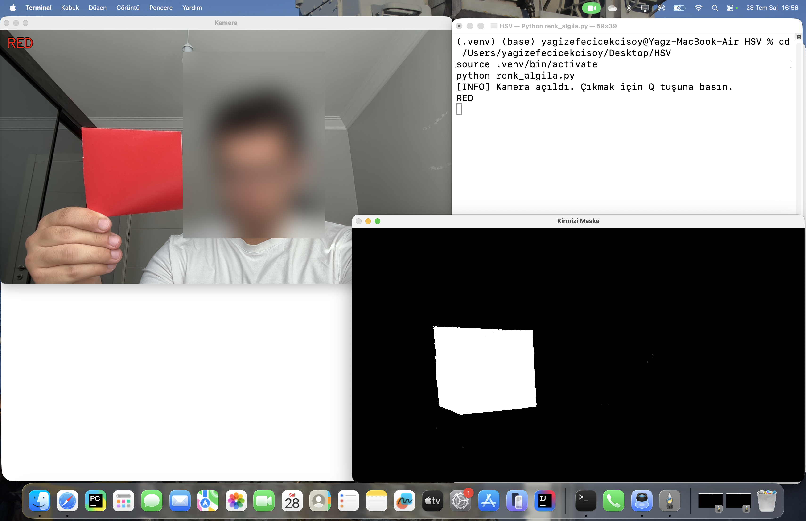
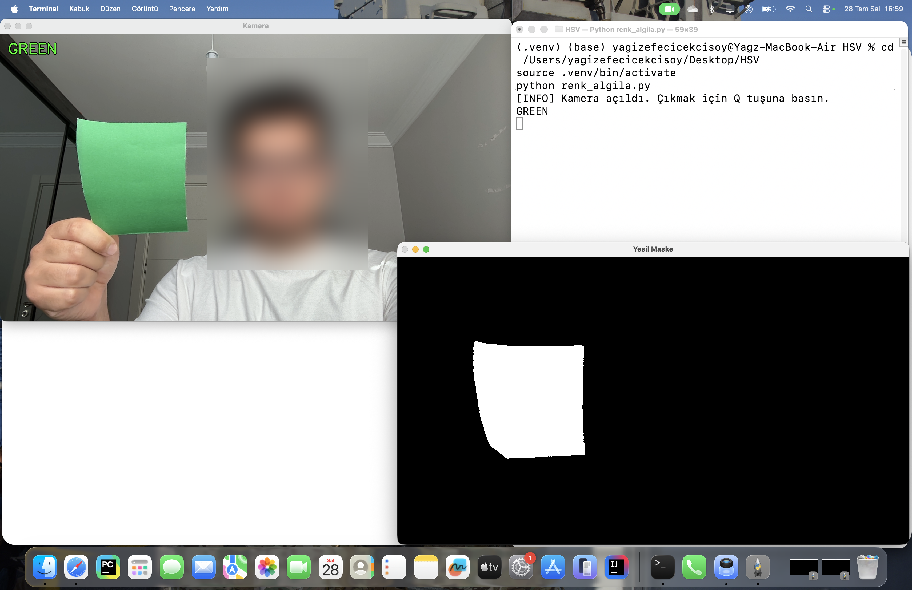
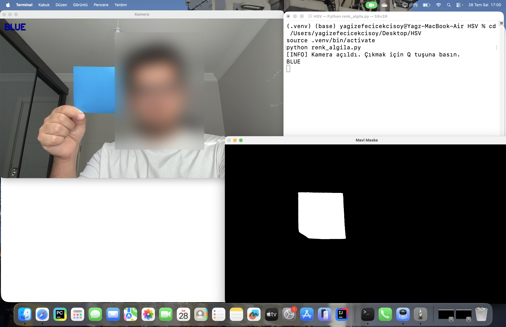

# Real-Time HSV Color Detection

A Python + OpenCV program that detects **red**, **green** and **blue** objects in a live webcam feed using the HSV color space.

Developed by team **GÖKBÖRÜ** for **TEKNOFEST 2026 – Smart Factory Systems Programming** (Task 3).



## Features

- Converts each camera frame from BGR to HSV and builds a binary mask for each color
- Uses two hue ranges for red, because red wraps around both ends of the hue scale
- Labels detected colors on the camera window (`RED` / `GREEN` / `BLUE`)
- Prints each newly detected color to the terminal once, not on every frame
- Shows each color's mask in its own window, which helps with tuning

## How it works

| Color | Lower HSV | Upper HSV |
|---|---|---|
| Red (range 1) | `(0, 180, 100)` | `(10, 255, 255)` |
| Red (range 2) | `(170, 180, 100)` | `(179, 255, 255)` |
| Green | `(30, 70, 40)` | `(86, 255, 255)` |
| Blue | `(88, 150, 100)` | `(140, 255, 255)` |

A color counts as detected when its mask has more than `PIKSEL_ESIGI = 5000` non-zero pixels. If you get false positives or missed detections under different lighting, change the HSV ranges or this pixel threshold.

## Installation

Requires Python 3.8+ and a webcam.

```bash
pip install -r requirements.txt
```

## Usage

```bash
python renk_algila.py
```

Hold a red, green or blue object in front of the camera. Press **Q** to quit.

## Screenshots

| Red | Green | Blue |
|---|---|---|
|  |  |  |

## Notes

The code comments and terminal messages are in Turkish, since the project was written for a Turkish competition.

## Author

Yağız Efe Çiçekçisoy (Team GÖKBÖRÜ)

## License

[MIT](LICENSE)
